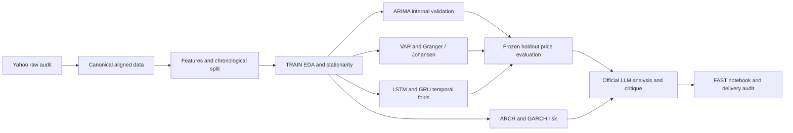

# AI-Chip Market Intelligence

**Multivariate Forecasting, Dynamic Interdependencies and Volatility Risk Analysis
of NVIDIA, AMD and the Semiconductor Market**

Mini-project for **Séries Temporelles pour Data Science & IA**, TEK-UP University,
academic year 2026/2027. Phases 1–8 are completed and published through
`v0.11.0-phase8`. Phase 9A prepares the executable notebook and technical delivery;
its commit is local until subsequently shared. The final report belongs to Phase 9B.

The study forecasts adjusted **NVDA** prices at **5 and 10 trading sessions**,
examines dynamic links with **AMD** and **SOXX**, and analyzes conditional
volatility as a separate risk target. Yahoo Finance observations cover
2018-01-02–2026-10-02, within the requested 2018-01-01–2026-10-02 period.
The canonical snapshot has 2200 common dates; TRAIN/TEST is chronological 90%/10%.
See [protocol](docs/protocol.md) and [data dictionary](docs/data_dictionary.md).



## Published findings

Naive remains the final recommended price model under the predeclared rule.
ARIMA has a small h10 RMSE lead but does not satisfy the full gain/MAE/DM criteria.
The locked LSTM and GRU configurations underperform Naive. VAR(9) is stable;
Johansen rank zero does not justify VECM. GARCH models persistent volatility,
with a conservative Normal lock despite Student-t's better likelihood; its
scores are not price forecasting scores. SARIMA was not justified.
See [final metrics](outputs/tables/phase7_final_metrics.csv),
[recommendation](outputs/tables/phase7_final_model_recommendation.csv),
[evaluation limits](docs/phase7_final_evaluation.md#limitations) and
[critical LLM audit](docs/phase8_llm_analysis.md).

These are **published historical results**. FAST displays them and performs
**newly reproduced consistency checks** on frozen outputs. It does not download
data, train models or produce a new holdout evaluation. FULL regeneration is
separate and may differ because of revised Yahoo data or numerical execution.

## Structure

| Folder | Contents |
| --- | --- |
| `data/raw`, `data/processed` | Ignored local CSVs; only placeholders in Git |
| `python/` | Canonical pipeline, classical/neural/evaluation scripts, Phase 9A checks |
| `r/` | Classical ARIMA, validation, VAR/Johansen and GARCH; EDA placeholder |
| `notebooks/` | Main executable scientific notebook |
| `outputs/tables`, `outputs/figures` | Versioned scientific results/provenance |
| `docs/` | Protocols, phase reports, Windows/RStudio/reproduction guides |
| `llm/` | Official prompt/response, development baselines and critical audit |
| `tests/` | Offline model contracts and delivery/provenance checks |
| `report/` | Final report planning; full writing deferred to 9B |

## Install and review — Windows PowerShell

From a checkout containing the Phase 9A commit, Python 3.12:

```powershell
py -3.12 -m venv .venv
.\.venv\Scripts\Activate.ps1
python -m pip install -r requirements.txt
python -m pip install -r requirements-dev.txt
python -m pip check
python python/09a_execute_notebook.py --clean-copy
python -m ruff check .
python -m pytest
```

Installations are manual. Use `.\.venv\Scripts\python.exe` if activation is
restricted. The observed scientific environment is Python 3.12.3, TensorFlow
2.21.0, native Windows CPU; no GPU is required. Base dependencies are not all
pinned. Detailed versions, path/locale issues and R packages are in
[team_setup_windows.md](docs/team_setup_windows.md).

Open [AI_Chip_Market_Intelligence.ipynb](notebooks/AI_Chip_Market_Intelligence.ipynb)
in a notebook-capable editor and select `.venv`, or execute with nbclient using
the command above. The development requirements provide kernel/execution tools,
not a server UI. Executed notebook copies are ignored under `.cache/phase9a/`.

## Data, R and team instructions

A clean clone contains **no market CSVs or neural weights**. FAST works with
the committed outputs only. FULL needs original snapshots or isolated regeneration
using actual scripts. Yahoo revisions are checked against historical manifests;
divergent inputs must not replace published outputs. Run
`python python/phase9a_review.py --data` to audit optional local CSVs.

Open `ai-chip-market-intelligence.Rproj` in the same root for RStudio. Model
dependencies are forecast, tseries, FinTS, vars, urca and rugarch. Reproduce only
in an isolated clone because historical scripts write official paths.
Follow [Windows/RStudio setup](docs/team_setup_windows.md) and
[FAST/FULL reproduction](docs/reproduction_guide.md). Never retune on the consumed
holdout or modify the official LLM response.

## Phase documentation

| Phase | Technical source |
| --- | --- |
| 1 | [Acquisition](docs/phase1_data_acquisition.md) |
| 1.5 | [Canonical preparation](docs/phase1_5_data_preparation.md) |
| 2 | [EDA and stationarity](docs/phase2_eda_stationarity.md) |
| 3A | [ARIMA identification](docs/phase3a_arima_identification.md) |
| 3B | [ARIMA temporal validation](docs/phase3b_arima_validation.md) |
| 4 | [VAR / Granger / Johansen](docs/phase4_var_vecm.md) |
| 5 | [GARCH](docs/phase5_garch.md) |
| 6 | [LSTM / GRU](docs/phase6_lstm_gru.md) |
| 7 | [Frozen final evaluation](docs/phase7_final_evaluation.md) |
| 8 | [Official LLM analysis and critique](docs/phase8_llm_analysis.md) |
| 9A | [Reproducibility and delivery](docs/phase9a_reproducibility.md) |

For the team: [repository audit](docs/phase9a_repository_audit.md),
[requirements checklist](docs/final_requirements_checklist.md),
[report figure selection](docs/final_figure_selection.md), and
[frozen SHA256 manifest](docs/phase9a_frozen_artifacts_manifest.json).
Phase 9B will prepare the 15–25-page report from the existing evidence.
