# AI-Chip Market Intelligence — Multivariate Forecasting, Dynamic Interdependencies and Volatility Risk Analysis of NVIDIA, AMD and the Semiconductor Market

**Rapport scientifique final**

TEK-UP

Cours : Séries Temporelles pour Data Science & IA

Année universitaire : 2026/2027

Membres de l’équipe : [noms et identifiants à compléter]

Enseignant : [nom à compléter]

Date de remise : [à compléter]

<!-- pagebreak -->

# Sommaire

<!-- toc -->

**Résumé.** Cette étude examine la prévision du prix ajusté de NVIDIA, les interdépendances entre NVIDIA, AMD et SOXX, et le risque de volatilité. Les transformations et diagnostics sont décidés sur TRAIN ; les modèles sont ensuite comparés sur un holdout chronologique selon un protocole gelé. Les analyses mettent en évidence des rendements compatibles avec la stationnarité, une précédence prédictive conditionnelle de SOXX et une variance persistante. Elles ne démontrent pas une supériorité prédictive générale des modèles complexes. Naive reste recommandé : ARIMA possède un léger avantage de RMSE à dix séances, mais échoue à la règle complète de remplacement. Les réseaux conservent leurs résultats défavorables. L’audit du LLM porte sur 35 affirmations soutenues, sans établir une fiabilité universelle. Le notebook FAST vérifie les résultats gelés ; la reproduction FULL reste PARTIAL.

**Mots-clés.** Séries temporelles, validation temporelle, ARIMA, VAR, Granger, GARCH, LSTM, GRU, Naive, audit LLM.

<!-- pagebreak -->

# 1 Introduction

## 1.1 Problématique et choix du terrain

Prévoir un prix financier impose de distinguer ce que les observations décrivent de ce qu’elles permettent réellement d’anticiper. Une tendance visible, une forte corrélation ou un ajustement satisfaisant sur le passé ne garantissent pas une faible erreur sur des observations futures. Notre question est donc précise : les modèles univariés, multivariés ou récurrents améliorent-ils suffisamment la prévision du prix ajusté de NVDA, à cinq et dix séances, pour remplacer la persistance du dernier prix ? Deux questions complémentaires concernent les interdépendances des rendements et la dynamique du risque.

Le secteur des semi-conducteurs fournit un cadre cohérent pour étudier simultanément des entreprises et une exposition sectorielle. NVDA et AMD constituent les deux séries d’entreprise retenues par le protocole. SOXX, l’iShares Semiconductor ETF, vise une exposition indicielle aux entreprises américaines du secteur ; cette fonction sectorielle est documentée par son émetteur [R1]. L’étude ne suppose ni composition constante du fonds, ni indépendance de SOXX vis-à-vis des entreprises du secteur. Ce panier n’est pas une mesure exhaustive du marché mondial des semi-conducteurs.

NVDA est la cible principale fixée avant la modélisation. AMD et SOXX apportent un contexte multivarié. Ce choix permet de confronter l’information propre à NVDA à celle de séries proches, sans transformer une association statistique en mécanisme économique établi. Aucune attribution de mouvement boursier à une annonce, une crise ou une innovation technologique n’est nécessaire à notre comparaison.

## 1.2 Une démarche articulée autour de trois objectifs

La prévision du prix mobilise Naive, ARIMA, VAR et les réseaux LSTM/GRU. ARIMA décrit la dépendance de la moyenne après différenciation ; VAR étudie les retards conjoints des rendements ; les réseaux apprennent une relation non linéaire entre une fenêtre passée et dix niveaux futurs. GARCH traite séparément la variance des innovations. Une meilleure représentation du risque n’équivaut donc pas à une meilleure prévision de prix.

La démarche suit trois étapes : identifier des propriétés sur TRAIN, verrouiller des choix après validation temporelle interne, puis mesurer les performances finales sur une période réservée. La documentation méthodologique distingue elle aussi l’ajustement et l’évaluation sur des données nouvelles [R2]. Les diagnostics influencent la construction des modèles ; ils ne se substituent pas aux erreurs de prévision finales.

Les chapitres 2 et 3 présentent les données et les transformations. Les chapitres 4 à 7 exposent les modèles, leurs diagnostics et leurs décisions. Le chapitre 8 compare les cinq prévisions de prix dans un cadre commun. Le chapitre 9 examine l’apport interprétatif du LLM. La discussion finale précise la portée des conclusions, les limites de reproduction et les prolongements possibles.

Source interne : `docs/protocol.md`, décisions D001–D011 dans `docs/decisions.md`.

<!-- pagebreak -->

# 2 Données et préparation

## 2.1 Acquisition et alignement des calendriers

Les observations journalières proviennent de Yahoo Finance via yfinance. L’acquisition canonique est effectuée en Python, actif par actif, avec conservation des champs OHLC, du prix ajusté et du volume. Le début demandé est le 1er janvier 2018 ; la première séance effectivement observée est le 2 janvier. La borne finale observée est le 2 octobre 2026. Le paramètre `end` de yfinance étant exclusif [R3], la requête utilise le 3 octobre comme borne technique. Les horizons du projet comptent des séances observées, sans ajouter les week-ends ou jours fériés.

Les fichiers bruts sont conservés localement et identifiés par SHA-256. Un téléchargement ultérieur peut recevoir un historique révisé : retrouver les mêmes dates ne suffit donc pas à retrouver les mêmes valeurs. Les manifestes distinguent l’identité des données, les paramètres de requête et les versions logicielles. Ils permettent de contrôler la provenance, sans garantir la permanence des données chez le fournisseur.

La préparation utilise l’intersection des trois calendriers, avec une jointure univoque sur Date. Dans le snapshot étudié, les calendriers coïncident et aucune date n’est perdue. Le dataset canonique contient 2200 lignes et 19 colonnes : Date et six variables financières pour chacun des trois actifs. Aucun remplissage de valeur manquante, ajustement supplémentaire, arrondi ou nettoyage des observations extrêmes n’est appliqué.

<!-- table: data -->

| Ensemble | Séances | Début | Fin |
| --- | --- | --- | --- |
| Canonique | 2200 | 2018-01-02 | 2026-10-02 |
| TRAIN | 1980 | 2018-01-02 | 2025-11-14 |
| TEST | 220 | 2025-11-17 | 2026-10-02 |

<!-- endtable: data -->

Tableau 1 — Périodes et effectifs. Sources : `outputs/tables/phase1_5_processed_manifest.csv` et `outputs/tables/phase2_split_metadata.csv`. Unité : séances observées ; dates ISO. Le partage est effectué sur les lignes canoniques avant exclusion des NA structurels.

Les audits d’acquisition et d’alignement ne détectent ni donnée manquante dans les champs canoniques, ni doublon de date, ni valeur infinie, ni prix non positif, ni contradiction OHLC. Ces constats décrivent les contrôles implémentés sur ce snapshot. Des calendriers identiques ne permettent pas de détecter une séance manquante simultanément dans les trois sources.

## 2.2 Prix fourni et prix ajusté

Close désigne la clôture historique fournie par Yahoo ; elle incorpore déjà ses ajustements de fractionnement. Adj Close tient également compte des distributions pertinentes. `auto_adjust=False` empêche un ajustement OHLC supplémentaire par yfinance et ne restaure pas un ancien prix brut de fractionnement. Les deux champs sont conservés, mais le prix ajusté est la référence historique et la cible finale. Son unité est l’USD ajusté par action. Un rendement est une variation relative entre deux séances : il ne doit pas être confondu avec un niveau de prix.

Sources internes : `docs/data_dictionary.md`, `docs/phase1_data_acquisition.md`, `docs/phase1_5_data_preparation.md`.

<!-- pagebreak -->

## 2.3 Transformations et séparation chronologique

Pour un prix ajusté positif P, le log-prix stabilise l’échelle relative des variations. Le log-rendement quotidien est exprimé en pourcentage ; le rendement simple reste une transformation distincte. La volatilité historique est l’écart-type des vingt rendements passés, annualisé par la convention de 252 séances. Cette fenêtre inclut la séance courante et n’utilise aucune observation future.

<!-- equation: log_return -->

La première différence est indéfinie à la première ligne. La volatilité exige vingt rendements valides : les vingt premières lignes de cette variable sont donc NA. Ces valeurs structurelles restent explicites ; elles ne sont pas imputées. Les cinq transformations par actif ajoutent quinze colonnes, portant le fichier de features à 34 colonnes. Les variations de volume sont conservées dans ce fichier, sans entrer automatiquement dans tous les modèles.

TRAIN contient les 1980 premières lignes ; TEST les 220 dernières. La première variation de TEST utilise le dernier prix de TRAIN, déjà connu à cette date. Le split chronologique empêche qu’un modèle apprenne sur un régime futur pour prédire une période antérieure. Les scalers et hyperparamètres sont ensuite ajustés dans les seuls préfixes d’entraînement appropriés, sans estimation sur TEST.

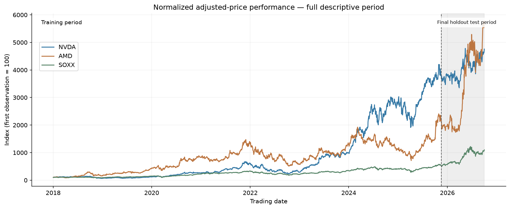

Figure 1 — Prix ajustés normalisés à 100 au premier jour observé. Source : `outputs/figures/phase2/normalized_prices_base100.png`. Périmètre : descriptif complet, 2018-01-02–2026-10-02, frontière TEST indiquée. Unité : indice base 100. Les différences de trajectoire sont descriptives et ne participent pas à la sélection des modèles.

La figure 1 rend comparables les évolutions relatives de prix initialement très différents. Elle montre des progressions irrégulières et des retournements, plutôt qu’une croissance uniforme. La normalisation utilise le premier prix et ne constitue pas un scaler ajusté sur toute la période. La partie TEST peut être visible dans une description historique ; les diagnostics qui déterminent les modèles restent limités à TRAIN. La protection du holdout porte sur le développement et le scoring final, sans prétendre que TEST n’a jamais été traité à des fins descriptives.

Source interne : `docs/phase2_eda_stationarity.md`, sections Chronological split et Financial transformations.

<!-- pagebreak -->

# 3 EDA et stationnarité

## 3.1 Dispersion et dépendance des rendements

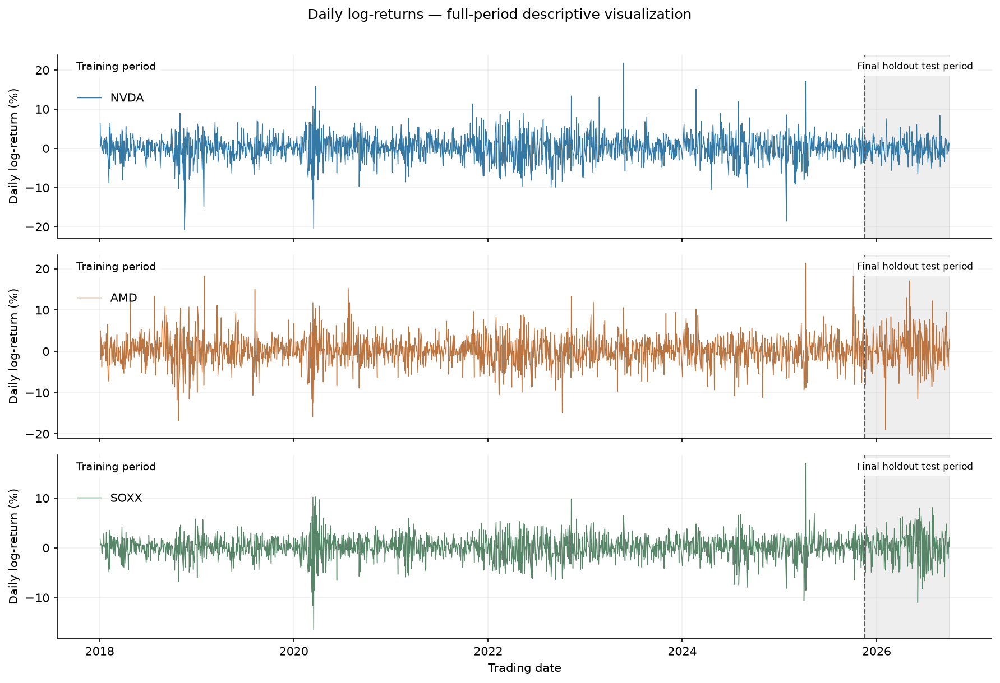

Figure 2 — Variations quotidiennes des prix ajustés. Source : `outputs/figures/phase2/log_returns.png`. Périmètre : descriptif complet, 2018-01-02–2026-10-02, TEST marqué. Unité : pourcentage logarithmique quotidien. Les amplitudes regroupées suggèrent une dynamique de variance ; elles n’identifient pas une cause économique.

Les rendements de la figure 2 oscillent autour de niveaux bien plus faibles que leur dispersion. Certaines séquences concentrent de grands mouvements, puis laissent place à des périodes plus calmes. Ce volatility clustering motive des diagnostics de variance ; le graphique seul ne constitue pas un test ARCH. Les statistiques utilisées pour les choix sont celles de TRAIN, même lorsque le contexte visuel couvre l’ensemble de la période.

<!-- table: descriptive -->

| Actif | n | Moyenne % | Écart-type % | Kurtosis exc. |
| --- | --- | --- | --- | --- |
| NVDA | 1979 | 0,185 | 3,244 | 4,698 |
| AMD | 1979 | 0,157 | 3,451 | 3,571 |
| SOXX | 1979 | 0,085 | 2,219 | 5,126 |

<!-- endtable: descriptive -->

Tableau 2 — Distribution des log-rendements sur TRAIN. Source : `outputs/tables/phase2_descriptive_stats.csv`, filtre `scope=train`, `series=Log_Return`. Moyenne et écart-type en pourcentage quotidien ; kurtosis excédentaire sans unité ; arrondi à trois décimales.

Le tableau 2 sépare deux dimensions du risque. AMD a la dispersion la plus élevée, tandis que SOXX a la kurtosis excédentaire la plus élevée. Une kurtosis élevée décrit des queues épaisses relatives à la forme normale et ne signifie pas nécessairement une volatilité globale supérieure. Les corrélations de Pearson contemporaines sur TRAIN sont positives : NVDA/AMD 0,685, NVDA/SOXX 0,819 et AMD/SOXX 0,745. Ces associations motivent l’étude multivariée, sans démontrer de causalité.

Les seuils IQR calculés sur TRAIN repèrent 74 rendements atypiques pour NVDA, 89 pour AMD et 74 pour SOXX. Ils sont tous conservés : une observation atypique peut être une variation de marché réelle. La supprimer automatiquement modifierait précisément le risque que l’étude cherche à décrire.

Sources : `outputs/tables/phase2_return_correlation_train.csv`, `outputs/tables/phase2_outlier_summary.csv`.

<!-- pagebreak -->

## 3.2 ACF PACF et tests complémentaires

La forte persistance des niveaux apparaît dans l’ACF des prix ajustés, reproduite en annexe A. Après différenciation logarithmique, la dépendance linéaire diminue fortement. L’ACF mesure l’association avec chaque retard ; la PACF isole la contribution d’un retard après les retards intermédiaires. Des pics isolés au-delà de bandes pointwise ne suffisent pas à fixer un ordre : ces bandes ne contrôlent pas simultanément tous les retards inspectés.

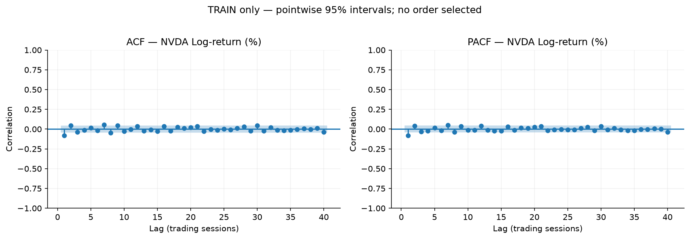

Figure 3 — Dépendance après différence logarithmique. Source : `outputs/figures/phase2/nvda_log_return_acf_pacf_train.png`. Périmètre : TRAIN, 2018-01-02–2025-11-14, 1979 rendements valides. Unité : corrélation sans dimension ; retards en séances, bandes ponctuelles à 95 %.

ADF teste une racine unitaire ; KPSS teste la stationnarité autour des termes déterministes spécifiés [R4, R5]. Les niveaux utilisent constante et tendance ; les rendements une constante. L’ADF choisit ses retards par AIC et KPSS par sa règle automatique. Leur lecture conjointe est plus informative qu’un test isolé.

<!-- table: stationarity -->

| Série | Actifs | ADF | KPSS | Lecture conjointe |
| --- | --- | --- | --- | --- |
| Adj_Close | NVDA AMD SOXX | Non rejet | Rejet | Non-stationnarité soutenue |
| Log_Price | NVDA AMD SOXX | Non rejet | Rejet | Non-stationnarité soutenue |
| Log_Return | NVDA AMD SOXX | Rejet | Non rejet | Stationnarité soutenue |

<!-- endtable: stationarity -->

Tableau 3 — Synthèse ADF/KPSS. Source : `outputs/tables/phase2_stationarity_summary.csv`. Périmètre : TRAIN ; trois actifs. Résultats catégoriels sans unité ; aucune nouvelle p-value calculée.

Pour NVDA log-prix, ADF donne p=0,461103 et KPSS une borne publiée de 0,01, avec p réelle inférieure. Pour son log-rendement, ADF donne environ 7,91 × 10⁻²⁷ ; KPSS publie 0,10, avec p réelle supérieure. Les tests soutiennent d=1 sans prouver un processus exactement I(1). Les bornes KPSS ne sont pas des probabilités exactes ; les zéros numériques ne désignent pas une probabilité mathématiquement nulle.

La STL robuste sur log-prix TRAIN, de période cinq séances, reste exploratoire. Ses lissages sont bilatéraux à l’intérieur de TRAIN et ne servent pas de features causales. Les différences par jour de semaine et une composante STL visible ne démontrent pas une saisonnalité exploitable. Cette réserve sera reprise dans la décision de ne pas estimer SARIMA.

Source : `outputs/tables/phase2_stationarity_tests.csv`, `docs/phase2_eda_stationarity.md`.

<!-- pagebreak -->

# 4 ARIMA et validation temporelle

## 4.1 Identification sur le log-prix

Un ARIMA(p,d,q) combine une différenciation d’ordre d, p retards autorégressifs et q retards d’innovations. Avec d=1, il décrit la variation du log-prix plutôt que son niveau persistant. Le drift représente une variation moyenne par séance, sans imposer une hausse quotidienne. La représentation ci-dessous utilise le polynôme autorégressif Φ, le polynôme de moyenne mobile Θ et l’opérateur de retard B.

<!-- equation: arima -->

Le choix d=1 vient des diagnostics TRAIN et est confirmé par trois vérifications `ndiffs()` en R. L’ACF/PACF ne présente pas de coupure suffisamment nette pour imposer un seul ordre. Cinq candidats manuels couvrent le random walk sans drift, le random walk avec drift et les modèles (1,1,0), (0,1,1), (1,1,1) avec drift. Ils permettent d’évaluer progressivement la dépendance moyenne et la complexité.

Les recherches automatiques sont bornées à p,q≤3, avec d fixé, sans saisonnalité et sans approximation de vraisemblance. `auto.arima` recherche un modèle selon les critères et contraintes fournis [R6]. En R, la proposition automatique est ARIMA(2,1,2) avec drift. En Python, `auto_arima` propose (3,1,3) sans drift ; une règle de parcimonie et de diagnostics retient provisoirement (1,1,1) avec drift, proche en AICc et plus simple. Les propositions ne sont pas assimilées à des gagnants prédictifs.

Les implémentations consomment le même TRAIN. Une sensibilité du (2,1,2) Python initialisé par les coefficients R rapproche sa vraisemblance de celle de R. Cela documente un effet d’initialisation et d’optima locaux ; cette vérification dépend de R et ne devient ni une réplication indépendante ni une preuve de maximum global. Les tentatives rejetées et avertissements de convergence restent dans les sorties.

## 4.2 Adéquation de la moyenne et limites des innovations

Le R (2,1,2) retenu provisoirement donne des p-values Ljung-Box de 0,869791 et 0,784385 aux retards 10 et 20. Le Python (1,1,1) donne 0,067465 et 0,118122. Ces non-rejets concernent l’autocorrélation linéaire testée, sans établir des innovations indépendantes. Jarque-Bera rejette fortement la normalité ; les p-values numériques nulles correspondent à un sous-flux. ARCH-LM rejette aux retards 5, 10 et 20 dans les deux langages. La moyenne est donc mieux représentée que la variance et les queues.

Le gate SARIMA reste fermé : la STL exploratoire, les retards saisonniers et les vérifications R ne fournissent pas l’évidence conjointe exigée. Aucun SARIMA n’est estimé. La figure R de diagnostics figure en annexe A ; les conclusions formelles proviennent des CSV et de leur convention de résidus.

Sources : `outputs/tables/phase3_arima_diagnostic_summary.csv`, `outputs/tables/phase3_seasonality_gate.csv`, `docs/phase3a_arima_identification.md`.

<!-- pagebreak -->

## 4.3 Validation rolling-origin exclusivement sur TRAIN

La Phase 3B déplace la question de l’ajustement vers la prévision. À chaque origine, les modèles sont estimés sur un préfixe croissant, puis évalués à cinq et dix séances. La fenêtre initiale contient 1386 lignes ; l’origine avance de dix séances. Les 59 origines vont du 2023-07-06 au 2025-10-27. Toutes les cibles restent dans TRAIN. La liste des candidats ayant été construite sur TRAIN complet, il s’agit d’une validation interne de sélection, sans prétendre à une évaluation entièrement imbriquée du processus d’identification.

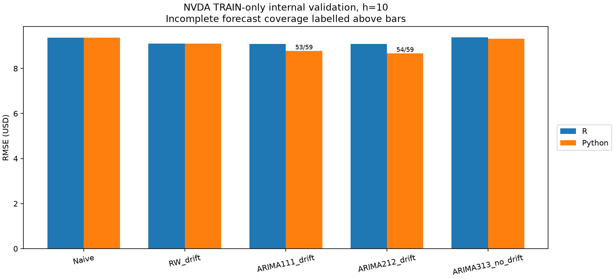

Figure 4 — Comparaison interne R/Python à h=10. Source : `outputs/figures/phase3b/phase3b_rmse_by_model_h10.png`. Périmètre : 59 origines TRAIN planifiées, 2023-07-06–2025-10-27 ; certains fits Python incomplets. Unité : USD ajustés. Les scores de panels incomplets ne sont pas directement comparables aux scores complets.

La figure 4 montre des gains possibles à dix séances. Ils doivent être confrontés aux deux horizons, aux erreurs absolues et à la couverture. Python ne conserve que 53 fits utilisables pour (1,1,1) et 54 pour (2,1,2), contre 59 pour Naive ; R couvre les 59. Les comparaisons de gain sont calculées sur les origines appariées, et les fits non convergents ne sont pas remplacés silencieusement.

La règle définie avant les résultats exige une convergence complète et au moins 1 % de gain en RMSE ET MAE aux deux horizons dans les deux langages. Aucun challenger ne satisfait toutes les conditions. La spécification verrouillée est donc Naive, ARIMA(0,1,0) sans drift, qui prévoit exactement le dernier prix observé. Le warning Ljung-Box du random walk reste conservé : le choix prédictif ne transforme pas ses résidus en bruit blanc validé.

Enfin, le protocole final inclut explicitement ARIMA(2,1,2) avec drift comme challenger pédagogique issu de la Phase 3A. Cette inclusion ne remplace pas le lock Naive de Phase 3B. Elle permet une comparaison finale pré-déclarée, sans rechercher un nouvel ordre sur le holdout. Qualité d’ajustement, choix interne et recommandation finale restent trois décisions distinctes.

Sources : `outputs/tables/phase3b_arima_validation_metrics.csv`, `outputs/tables/phase3b_baseline_comparison.csv`, `outputs/tables/phase3b_locked_arima_model.csv`, `docs/phase7_final_evaluation_protocol.md`.

<!-- pagebreak -->

# 5 Modélisation multivariée

## 5.1 VAR sur les rendements stationnaires

Le VAR modélise le vecteur des trois log-rendements, dans l’ordre NVDA, AMD, SOXX, à partir de ses retards et d’une constante. Chaque équation reçoit ainsi son passé et celui des autres séries. Les 1979 rendements TRAIN valides constituent l’entrée ; les log-prix non stationnaires ne sont pas utilisés dans ce VAR standard.

<!-- equation: var -->

Les critères AIC, BIC, HQIC et FPE proposent tous un retard 1. Leur calcul repose sur le même échantillon de réponses à tous les ordres 1–10, conformément au principe de `VARselect` [R7]. Toutefois, VAR(1) échoue aux diagnostics sériels à 20 et 30 séances : p≈0,000210 et 0,001378. Seuls les ordres 9 et 10 satisfont les deux non-rejets exigés. VAR(9), moins complexe et de meilleur BIC parmi ces modèles éligibles, est retenu. Il ne s’agit donc pas d’un désaccord AIC/BIC, mais d’une sélection conditionnée par l’adéquation résiduelle.

Le système contient 84 coefficients de moyenne, distincts des six composantes uniques de covariance. Le module compagnon maximal vaut 0,840223, inférieur à 1. La stabilité rend possible l’analyse des réponses aux innovations ; elle ne valide pas toutes les hypothèses. Les p-values Portmanteau de VAR(9), 0,058790 à 20 et 0,156800 à 30 séances, ne prouvent pas l’absence de dépendance, et la première reste proche du seuil. La normalité multivariée est fortement rejetée.

## 5.2 Précédence prédictive et correction multiple

<!-- table: granger -->

| Prédicteur → cible | p brute | p Holm | À 5 % après Holm |
| --- | --- | --- | --- |
| NVDA → AMD | 0,464045 | 1,000000 | Non soutenu |
| NVDA → SOXX | 0,464486 | 1,000000 | Non soutenu |
| AMD → NVDA | 0,231963 | 0,927853 | Non soutenu |
| AMD → SOXX | 0,737034 | 1,000000 | Non soutenu |
| SOXX → NVDA | 0,000066 | 0,000394 | Soutenu |
| SOXX → AMD | 0,009167 | 0,045834 | Soutenu |

<!-- endtable: granger -->

Tableau 4 — Tests de Granger conditionnels. Source : `outputs/tables/phase4_granger_causality_comparison.csv`. Périmètre : VAR(9), TRAIN ; six tests dirigés, Wald à neuf restrictions par équation. P-values sans unité, R affiché, décisions R/Python concordantes ; correction Holm sur les six tests, arrondi à six décimales.

Le passé de SOXX apporte une information prédictive supplémentaire pour NVDA et AMD dans ce système. SOXX→AMD reste plus proche du seuil après Holm. Les autres directions ne sont pas soutenues ; leur non-rejet ne prouve pas une absence de prévisibilité. Granger est une précédence prédictive conditionnelle, sans identification causale économique. Holm contrôle la multiplicité de six tests, sans corriger la sélection préalable du lag, les ruptures ou l’hétéroscédasticité des tests Wald conventionnels.

Sources : `outputs/tables/phase4_r_python_summary.csv`, `outputs/tables/phase4_var_lag_selection_comparison.csv`, `docs/phase4_var_vecm.md`.

<!-- pagebreak -->

## 5.3 Johansen et dynamique des innovations

La cointégration concerne des combinaisons stationnaires de niveaux individuellement non stationnaires. Johansen reçoit donc les 1980 log-prix TRAIN. La spécification principale utilise trois retards en niveaux, soit deux retards de différences [R8]. Elle est distincte du VAR(9) sur rendements et n’hérite pas de son adéquation sérielle. Les statistiques concordent, mais les tables critiques natives R/Python diffèrent et sont conservées.

Au rang nul, la trace vaut 21,570119, sous les seuils à 5 % de 31,52 en R et 29,7961 en Python. La procédure séquentielle retient le rang 0 ; les sensibilités voisines à deux et quatre retards en niveaux donnent aussi 0. La cointégration n’est pas soutenue dans ces spécifications. Le VECM n’est donc pas justifié, et aucun coefficient α ou β de VECM n’est inventé. Le résultat dépend des retards, termes déterministes et de la puissance des tests.

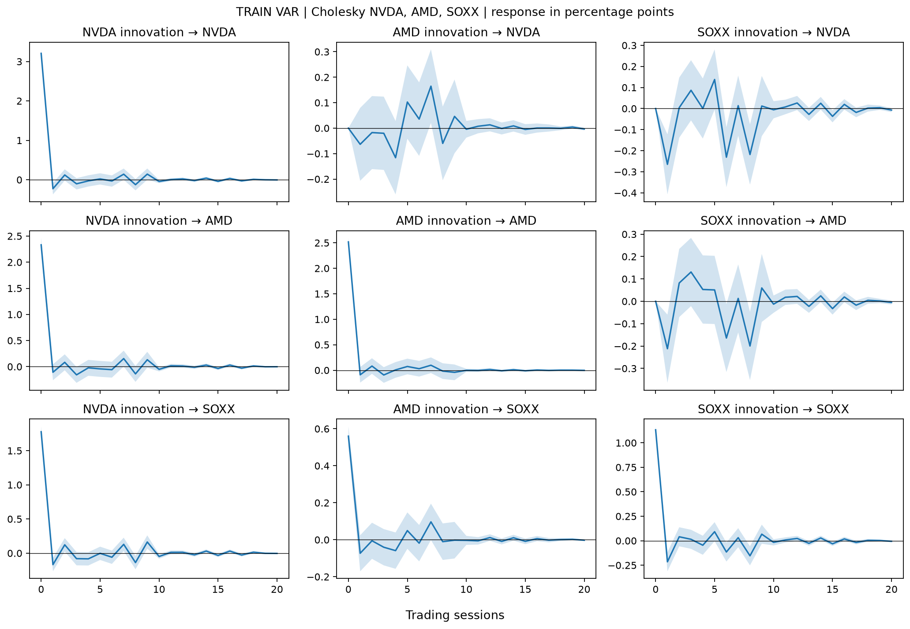

Figure 5 — IRF orthogonalisées du VAR(9). Source : `outputs/figures/phase4/phase4_var_irf.png`. Périmètre : TRAIN, 2018-01-02–2025-11-14 ; horizons 0–20 séances. Unité : points de pourcentage de rendement quotidien pour une innovation orthogonalisée d’un écart-type. Ordre de Cholesky : NVDA, AMD, SOXX ; bandes Python asymptotiques ponctuelles à 95 %.

Les réponses de la figure 5 oscillent puis s’atténuent, ce qui est cohérent avec le système stable. L’identification récursive impose certaines réponses contemporaines nulles par construction ; les innovations ne sont pas des interventions économiques observées. Les bandes ne sont ni simultanées ni conçues ici pour garantir une robustesse à la volatilité variable.

La FEVD, reproduite en annexe B, répartit à vingt séances la variance d’erreur NVDA entre ses propres innovations (97,517 %), AMD (0,591 %) et SOXX (1,892 %). Ces parts dépendent de l’ordre de Cholesky. Une Granger significative peut coexister avec une faible part FEVD : les deux analyses ne mesurent pas le même objet, et aucune ne garantit un gain de prévision de prix sur TEST.

Sources : `outputs/tables/phase4_johansen_rank_comparison.csv`, `outputs/tables/phase4_vecm_decision.csv`, `outputs/tables/phase4_var_fevd.csv`.

<!-- pagebreak -->

# 6 Volatilité ARCH et GARCH

## 6.1 Filtrer la moyenne avant la variance

La variance conditionnelle peut rester prévisible même lorsque les rendements ont peu de dépendance linéaire. Pour isoler les innovations, R et Python appliquent un ARMA(1,1) commun aux rendements NVDA, avec moyenne inconditionnelle. Le filtre est gelé avant l’estimation de variance. Il ne modifie pas le choix Naive pour la prévision du prix.

Les ARCH-LM pré-GARCH rejettent l’absence d’effets ARCH aux retards 5, 10 et 20, dans les deux implémentations, avec des p-values de l’ordre de 10⁻¹³ à 10⁻¹². Les diagnostics ouvrent ainsi le gate de variance ; la seule observation visuelle de clusters n’aurait pas suffi. GARCH(1,1) représente cette variance par une constante positive, le carré de l’innovation passée et la variance passée [R9].

<!-- equation: garch -->

ω a l’unité de points de pourcentage au carré ; α mesure la réaction à une innovation récente et β la mémoire de variance. Les innovations sont exprimées en points de pourcentage, et σ en pourcentage quotidien. Le modèle est symétrique : il réagit au carré du choc, sans différence automatique selon son signe.

<!-- table: garch -->

| Langue / loi | ω | α | β | α+β | Demi-vie |
| --- | --- | --- | --- | --- | --- |
| R / Normal | 0,4417 | 0,1126 | 0,8516 | 0,9642 | 19,00 |
| R / Student-t | 0,3066 | 0,0950 | 0,8793 | 0,9743 | 26,61 |
| Python / Normal | 0,4371 | 0,1116 | 0,8529 | 0,9645 | 19,18 |
| Python / Student-t | 0,3030 | 0,0940 | 0,8805 | 0,9745 | 26,85 |

<!-- endtable: garch -->

Tableau 5 — Paramètres et persistance. Source : `outputs/tables/phase5_garch_model_comparison.csv` et `outputs/tables/phase5_garch_persistence.csv`. Périmètre : 1979 innovations TRAIN ; ω en points de pourcentage², α/β/persistance sans unité, demi-vie en séances. Arrondis à quatre décimales, demi-vie à deux.

La persistance α+β est proche de 1, mais inférieure à 1 pour les quatre fits. Sous le modèle à paramètres constants, la demi-vie vaut ln(0,5)/ln(α+β), environ dix-neuf séances pour Normal et vingt-sept pour Student-t. Cette décroissance théorique est une propriété d’estimation ponctuelle, sans intervalle d’incertitude ni garantie de stabilité entre régimes.

## 6.2 Normal et Student t

Les queues épaisses motivent une Student-t standardisée de variance unitaire, avec des degrés de liberté proches de 5,76. Elle améliore AIC et BIC dans les deux langages. Cependant, la règle commune exige aussi une amélioration du score de six quantiles de queue dans les deux implémentations. Le score se dégrade en R et s’améliore en Python. Normal reste donc verrouillé selon la règle pré-déclarée ; ce choix ne démontre pas que les queues sont gaussiennes. Student-t reste une alternative crédible.

Sources : `outputs/tables/phase5_arch_lm_pre_garch.csv`, `outputs/tables/phase5_distribution_selection_checks.csv`, `outputs/tables/phase5_locked_garch_model.csv`.

<!-- pagebreak -->

## 6.3 Diagnostics et sens de la prévision de risque

Après standardisation z=ε/σ, les tests Ljung-Box sur z et z² aux retards 10 et 20, et ARCH-LM aux retards 5, 10 et 20, ne rejettent pas à 5 %. Les corrections Holm des diagnostics de variance ne changent pas cette conclusion. Aucun ARCH résiduel n’est détecté aux lags testés ; cela ne prouve ni iid ni absence de toute dynamique restante. Le gate d’ordres supérieurs reste fermé, et aucune extension asymétrique n’est estimée.

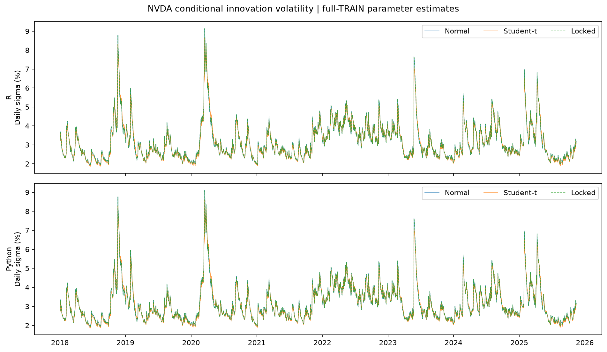

Figure 6 — Sigmas ajustées Normal et Student-t. Source : `outputs/figures/phase5/phase5_conditional_volatility.png`. Périmètre : TRAIN, 2018-01-02–2025-11-14 ; première valeur structurellement indéfinie. Unité : pourcentage quotidien, non annualisé. Paramètres estimés sur TRAIN complet ; trajectoires rétrospectives, non disponibles à chaque origine passée sans réestimation.

La figure 6 montre des épisodes de variance élevée qui se dissipent progressivement. Les deux langages donnent des trajectoires proches, avec des différences d’initialisation. Les pics décrivent des concentrations de risque ; aucune annonce économique particulière ne leur est attribuée. Ces sigmas rétrospectives ne sont pas ajoutées aux features neuronales, car elles utiliseraient des paramètres estimés au-delà d’une ancienne origine.

Depuis le 2025-11-14, le modèle Normal prévoit à h=10 une variance de 10,055229 points de pourcentage² en R et 10,038995 en Python. Les sigmas quotidiennes correspondantes sont 3,170998 % et 3,168437 %, soit environ 3,17 %. Il s’agit de l’incertitude de l’innovation au dixième horizon. Ce nombre n’est ni un rendement signé, ni un profit attendu, ni le risque cumulé sur dix séances. La variance des innovations se distingue également de la variance d’erreur du rendement après propagation par le filtre ARMA [R10].

L’étude n’évalue pas de perte de volatilité sur un holdout et ne garantit pas la calibration de cette prévision. L’estimation en deux étapes ignore la propagation de l’incertitude des coefficients de moyenne. Des ruptures et effets d’asymétrie peuvent subsister malgré les non-rejets. Ces limites expliquent pourquoi le diagnostic GARCH reste une analyse de risque distincte du classement final de prix.

Sources : `outputs/tables/phase5_garch_standardized_residual_diagnostics.csv`, `outputs/tables/phase5_volatility_forecast_train_end.csv`, `docs/phase5_garch.md`.

<!-- pagebreak -->

# 7 LSTM et GRU

## 7.1 Fenêtres multivariées et prévention des fuites

Les réseaux récurrents peuvent représenter des relations temporelles non linéaires. LSTM conserve un état de cellule et des portes ; GRU utilise une structure plus compacte [R11, R12]. Leur intérêt potentiel doit être évalué face à Naive : leur présence dans l’étude n’implique aucun avantage prédictif préalable.

Une fenêtre se termine à l’origine t et commence à t−L+1. Elle contient cinq features : log-prix NVDA, log-rendement NVDA, volatilité historique NVDA sur vingt séances annualisée, log-rendement AMD et log-rendement SOXX. Une couche Dense(10) produit directement les dix log-prix futurs. h5 et h10 sont deux sorties de ce vecteur, sans réinjection récursive des prix prédits. Les niveaux exponentiés ne reçoivent pas de correction de biais lognormal.

La suppression des vingt lignes de warm-up laisse 1960 lignes TRAIN utilisables. Trois folds expanding-window fournissent chacun 196 séances externes et 187 origines communes, soit 561 prévisions par candidat et horizon. Les blocs externes vont respectivement de juillet 2023 à avril 2024, d’avril 2024 à février 2025, puis de février à novembre 2025. Ils ne sont jamais utilisés pour les gradients ou l’early stopping.

Les scalers X et y sont ajustés sur le préfixe TRAIN de chaque fold ; le scaler y est scalaire et commun aux dix sorties. Chaque séance est comptée une seule fois, avant duplication en fenêtres. Le dernier dixième de ce TRAIN fournit la loss d’arrêt ; neuf fenêtres de cibles chevauchant la frontière interne sont purgées. Cette portion interne appartient à TRAIN et à l’ajustement du scaler : sa loss est un dispositif d’arrêt, sans être présentée comme un score indépendant.

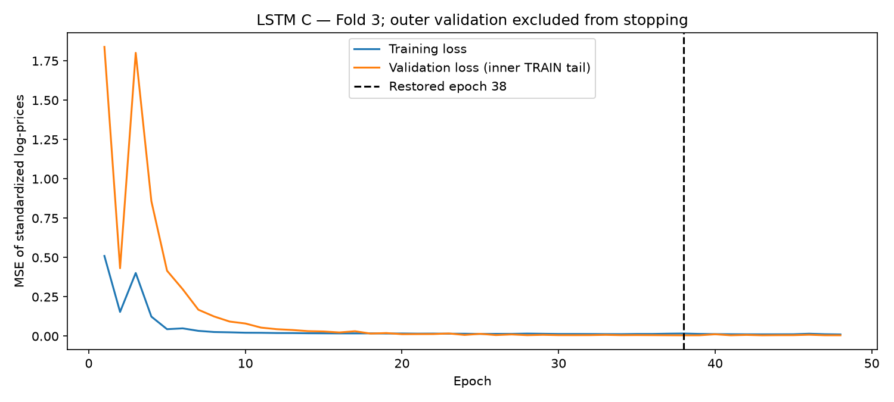

Figure 7 — Loss LSTM C, fold 3. Source : `outputs/figures/phase6/phase6_lstm_loss_curve.png`. Périmètre : optimisation et validation d’arrêt internes au TRAIN du fold 3, terminé le 2025-02-05 ; epochs sans date de marché. Unité : MSE des log-prix standardisés, sans unité. Le bloc externe et TEST ne pilotent pas l’arrêt.

La chute initiale de loss de la figure 7 indique un apprentissage de l’objectif interne. La remontée tardive de la loss d’arrêt motive la restauration des poids de l’epoch 38. Elle ne démontre pas une bonne généralisation : celle-ci doit être jugée sur les origines externes.

Sources : `outputs/tables/phase6_temporal_folds.csv`, `outputs/tables/phase6_scaler_audit.csv`, `docs/phase6_lstm_gru.md`.

<!-- pagebreak -->

## 7.2 Configurations bornées et résultats négatifs

La grille fixe A : fenêtre 20, 32 unités, dropout 0,10 ; B : fenêtre 60, 32 unités, dropout 0,10 ; C : fenêtre 60, 64 unités, dropout 0,20. Les deux architectures utilisent Adam, taux 0,001, loss MSE, batch 32, au plus 100 epochs, patience 10, restauration des meilleurs poids et absence de shuffle [R13]. La seed principale est 42. Le score de sélection est la moyenne de six ratios RMSE modèle/Naive, avec même poids pour chaque fold et horizon, et non le ratio des scores USD poolés.

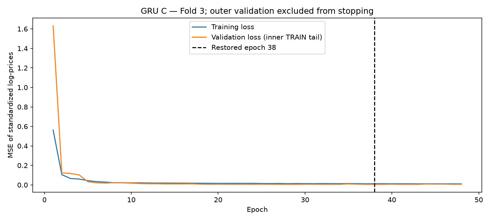

Figure 8 — Loss GRU C, fold 3. Source : `outputs/figures/phase6/phase6_gru_loss_curve.png`. Périmètre : TRAIN interne du fold 3, terminé le 2025-02-05. Unité : MSE des log-prix standardisés ; axe horizontal en epochs. 48 epochs effectuées, poids de l’epoch 38 restaurés, comme pour LSTM.

La figure 8 montre elle aussi une stabilisation suivie d’une légère dégradation interne. Le dropout est actif pendant l’optimisation et inactif pendant la validation ; l’écart entre les deux losses ne constitue pas à lui seul un test calibré de surapprentissage. Les petites variations finales sont plus lisibles dans l’historique numérique que sur l’échelle dominée par les premières epochs.

C est retenu séparément pour LSTM et GRU. LSTM C contient 18570 paramètres, GRU C 14282. Leurs ratios moyens RMSE de sélection valent respectivement 2,319180 et 1,651779, donc plus de deux fois et environ une fois et demie la référence selon ce score interne. Les deux réseaux perdent face à Naive en RMSE et MAE poolées aux deux horizons. GRU est meilleur que LSTM dans cette validation ; cela ne constitue pas une supériorité architecturale générale.

Après verrouillage, les refits utilisent tout TRAIN admissible, avec 38 epochs fixes pour LSTM et 36 pour GRU, sans arrêt piloté par TEST. Les 18 entraînements principaux et les deux refits coûtent environ 1208,461 secondes, soit 20,14 minutes sur le CPU observé. Ce temps exclut préparation, scoring, figures et tests ; il ne prédit pas la durée de toute reproduction FULL. Une seed, une grille restreinte, les fenêtres chevauchantes et l’extrapolation de niveaux non stationnaires limitent la portée des conclusions.

Sources : `outputs/tables/phase6_locked_lstm.csv`, `outputs/tables/phase6_locked_gru.csv`, `outputs/tables/phase6_validation_metrics_summary.csv`, `outputs/tables/phase6_training_runs.csv`, `outputs/tables/phase6_full_train_refits.csv`.

<!-- pagebreak -->

# 8 Évaluation finale

## 8.1 Un protocole commun gelé avant le scoring

Le protocole final est commité avant l’accès TEST du runner de Phase 7, au commit `1e5ad76c6834f4e24fee825c894261597c94c917`. Les 220 lignes du holdout sont évaluées avec 211 origines communes, du 2025-11-14 au 2026-09-18. L’origine initiale est la dernière séance TRAIN. Les mêmes modèles, horizons, dates cibles et observations réelles sont utilisés ; aucun challenger n’est exclu après lecture de ses pertes.

Les coefficients ARIMA/VAR, poids neuronaux et scalers sont gelés. L’historique observé peut avancer jusqu’à l’origine ; les états ARIMA sont actualisés par `append(refit=False)` [R14]. Le VAR prévoit des rendements, puis reconstitue le log-prix en cumulant les rendements divisés par 100. Les réseaux utilisent les soixante dernières lignes disponibles et leurs dix sorties directes. Toutes les features se terminent au plus tard à l’origine.

<!-- table: final_metrics -->

| Modèle | h | MSE USD² | RMSE USD | MAE USD | MAPE % |
| --- | --- | --- | --- | --- | --- |
| Naive | 5 | 93,810 | 9,686 | 7,688 | 3,847 |
| ARIMA(2,1,2) | 5 | 93,995 | 9,695 | 7,703 | 3,880 |
| VAR(9) | 5 | 95,344 | 9,764 | 7,845 | 3,947 |
| LSTM C | 5 | 274,924 | 16,581 | 13,398 | 6,584 |
| GRU C | 5 | 187,608 | 13,697 | 10,766 | 5,311 |
| Naive | 10 | 131,923 | 11,486 | 9,075 | 4,490 |
| ARIMA(2,1,2) | 10 | 130,866 | 11,440 | 9,404 | 4,709 |
| VAR(9) | 10 | 132,360 | 11,505 | 9,253 | 4,634 |
| LSTM C | 10 | 181,648 | 13,478 | 9,911 | 4,910 |
| GRU C | 10 | 215,001 | 14,663 | 11,172 | 5,464 |

<!-- endtable: final_metrics -->

Tableau 6 — Comparaison finale unique des cinq modèles à h5 et h10. Source : `outputs/tables/phase7_final_metrics.csv`. Périmètre : holdout final, 211 origines communes par ligne ; h en séances ; MSE en USD ajustés², RMSE/MAE en USD ajustés, MAPE en %. Arrondi à trois décimales, sans nouveau calcul des modèles.

Pour une erreur e=prévision−observation, MSE est la moyenne de e², RMSE sa racine carrée, MAE la moyenne de |e| et MAPE cent fois la moyenne de |e|/prix réel positif. RMSE pénalise davantage les grandes erreurs ; MAE décrit un écart absolu moyen, et MAPE apporte une échelle relative. Les niveaux de prix variant au fil du temps, ces métriques ne sont pas interchangeables.

Naive est premier en RMSE à h5 et premier en MAE/MAPE aux deux horizons. ARIMA est légèrement premier en RMSE à h10, tout en ayant une MAE supérieure à Naive. Les réseaux présentent des RMSE/MAE supérieures aux deux horizons. GARCH est exclu du classement : sa cible est la variance d’innovation, et aucune perte de volatilité holdout n’est disponible.

Sources : `outputs/tables/phase7_holdout_manifest.csv`, `outputs/tables/phase7_evaluation_origins.csv`, `outputs/tables/phase7_target_scope_note.csv`.

<!-- pagebreak -->

## 8.2 Lecture des erreurs selon l’horizon

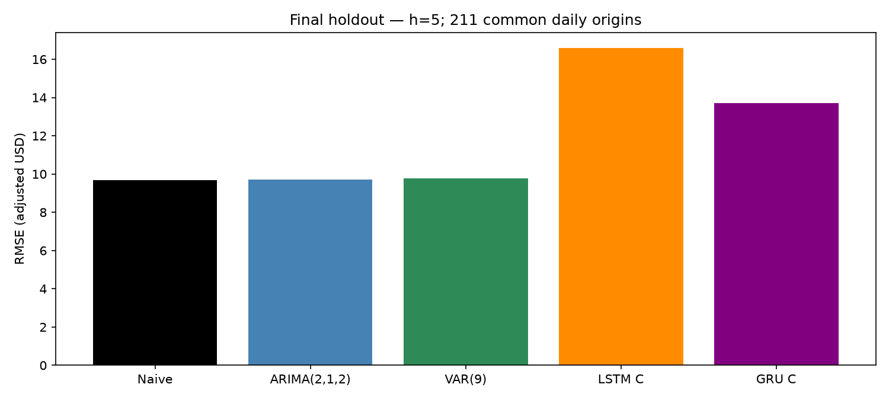

Figure 9 — RMSE à h5. Source : `outputs/figures/phase7/phase7_rmse_comparison_h5.png`. Périmètre : TEST final, cibles 2025-11-21–2026-09-25, 211 origines communes. Unité : USD ajustés. Les écarts entre modèles classiques sont faibles face aux pertes neuronales.

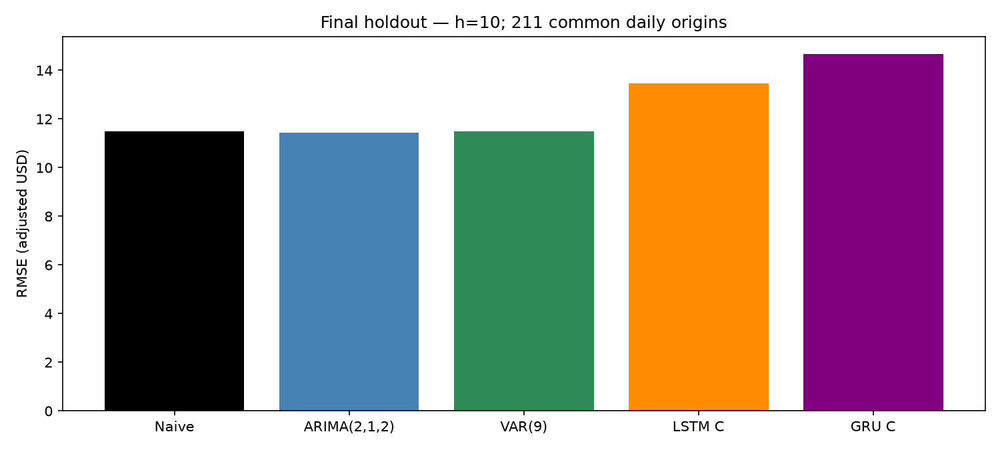

Figure 10 — RMSE à h10. Source : `outputs/figures/phase7/phase7_rmse_comparison_h10.png`. Périmètre : TEST final, cibles 2025-12-01–2026-10-02, mêmes 211 origines. Unité : USD ajustés. Le premier rang ARIMA ne suffit pas à satisfaire la règle de recommandation.

Les figures 9 et 10 visualisent les valeurs du tableau 6, sans modifier le classement. Les trajectoires alignées sur les dates cibles sont présentées en annexe C. Le RMSE LSTM est plus faible à h10 qu’à h5 : ses sorties directes sont apprises séparément, et une augmentation de l’erreur avec l’horizon n’est pas une nécessité mathématique. Cette observation ne signifie pas que ses prévisions sont précises face au benchmark.

ARIMA et VAR restent proches de Naive en RMSE, mais cette proximité descriptive doit être confrontée à la MAE, aux conditions pratiques pré-déclarées et à l’inférence sur les pertes appariées. L’évaluation est une comparaison de clôture observée vers clôture future, avec les trois informations de clôture supposées disponibles à l’origine. Elle n’évalue pas l’exécution d’ordres de marché.

<!-- pagebreak -->

## 8.3 Diebold Mariano et recommandation

Diebold-Mariano teste l’égalité de la perte prédictive attendue. Le différentiel est perte A−perte B ; un signe négatif favorise A. Les erreurs se chevauchent : la variance de long terme est estimée par HAC Bartlett/Newey-West, avec retard h−1. La statistique reçoit la correction Harvey-Leybourne-Newbold et une référence t à 210 degrés de liberté, selon les formules documentées dans forecast [R15]. Holm ajuste séparément quatre comparaisons contre Naive par horizon.

<!-- table: dm -->

| A contre Naive | h | p brute | p Holm | Conclusion |
| --- | --- | --- | --- | --- |
| ARIMA(2,1,2) | 5 | 0,96563 | 1 | Non rejet |
| VAR(9) | 5 | 0,768531 | 1 | Non rejet |
| LSTM C | 5 | 1,21421e-05 | 4,85686e-05 | Naive |
| GRU C | 5 | 0,000191962 | 0,000575887 | Naive |
| ARIMA(2,1,2) | 10 | 0,936111 | 1 | Non rejet |
| VAR(9) | 10 | 0,97401 | 1 | Non rejet |
| LSTM C | 10 | 0,0747353 | 0,224206 | Non rejet |
| GRU C | 10 | 0,00124138 | 0,00496551 | Naive |

<!-- endtable: dm -->

Tableau 7 — DM bilatéral des challengers contre Naive. Source : `outputs/tables/phase7_diebold_mariano.csv`, filtre `model_b=Naive`. Périmètre : 211 pertes appariées par horizon ; p-values sans unité, six chiffres significatifs. « Naive » signifie rejet à 5 % après Holm et perte moyenne plus faible pour Naive ; « non rejet » ne signifie pas équivalence.

ARIMA et VAR n’ont pas d’amélioration statistiquement soutenue face à Naive. À h5, les deux réseaux ont une perte significativement plus élevée après Holm ; à h10, c’est établi pour GRU, tandis que LSTM n’est pas rejeté. Les tests GRU/LSTM constituent une comparaison séparée avec p-values brutes, conservée dans le CSV complet. Un non-rejet DM ne prouve pas la même précision : puissance, dépendance, queues lourdes et modèles imbriqués limitent sa calibration.

La règle exige RMSE et MAE non pires aux deux horizons, au moins 1 % de gain sur la moyenne des deux ratios RMSE, une baisse de perte soutenue par Holm à au moins un horizon et aucun horizon significativement pire. ARIMA a un ratio moyen RMSE de 0,998485622, soit seulement 0,1514 % de gain, une MAE moins bonne et aucun soutien DM. Aucun challenger n’est éligible : **le modèle final recommandé est Naive**. Ce choix ne prétend ni à une optimalité universelle, ni à un vrai processus générateur de marche aléatoire.

Les intervalles ARIMA nominalement à 95 % couvrent 100 % des cibles observées, avec des largeurs moyennes de 54,202430 USD à h5 et 77,390142 à h10. Des intervalles larges et chevauchants n’établissent pas une calibration future. Ils ne remplacent pas les diagnostics historiques d’ARCH et de non-normalité.

Sources : `outputs/tables/phase7_recommendation_checks.csv`, `outputs/tables/phase7_final_model_recommendation.csv`, `outputs/tables/phase7_arima_interval_coverage.csv`.

<!-- pagebreak -->

# 9 IA générative et analyse critique

## 9.1 Une interprétation rétrospective structurée

Le LLM reçoit les faits après la modélisation et l’évaluation finale. Le prompt officiel demande quatre sections : A, hypothèses de modèles ; B, vulgarisation ; C, interprétation d’investissement simulée ; D, revue critique. Il contient les résultats, leurs sources et les précautions. Le LLM ne propose donc pas une sélection prospective indépendante ; il reformule un dossier déjà connu.

La section A relie stationnarité, dépendance et variance aux familles étudiées. B traduit les concepts pour un lecteur non technique. C conserve une simulation académique, sans allocation, ordre d’achat/vente ni rendement garanti. D rappelle la portée des non-rejets, les différences prix/risque et la décision Naive. Les formulations correctes contribuent à la synthèse, sans ajouter de résultat scientifique.

Les analyses de base ont été assistées puis revues par l’équipe. Elles ne constituent pas une évaluation humaine indépendante aveugle. La comparaison est documentaire et rétrospective, sans compétition expérimentale pure humain/IA. L’identité exacte du modèle, sa version et ses métadonnées de génération ne sont pas disponibles. Le commit d’enregistrement ne permet pas d’inférer l’heure de génération.

<!-- table: llm -->

| Section | Affirmations | Supported | Autres catégories détectées |
| --- | --- | --- | --- |
| A | 11 | 11 | 0 |
| B | 8 | 8 | 0 |
| C | 6 | 6 | 0 |
| D | 10 | 10 | 0 |
| Total | 35 | 35 | 0 |

<!-- endtable: llm -->

Tableau 8 — Audit des affirmations de la réponse officielle. Source : `llm/human_analysis/phase8_hallucination_audit.csv`. Périmètre : une réponse A/B/C/D et 35 affirmations matérielles regroupées ; unité : lignes d’audit, non observations indépendantes. Comptages issus du CSV ; catégories sans unité.

## 9.2 Apports et réserves

Les 35 affirmations sont classées supported ; aucune hallucination numérique n’est détectée dans les valeurs matérielles vérifiées. Ce résultat borné ne mesure pas la fiabilité générale d’un LLM. Le prompt fournit lui-même les faits : leur reprise fidèle ne démontre ni prévision autonome ni accès indépendant aux sources. Certaines citations locales sont imprécises, notamment pour la corrélation et la persistance GARCH ; l’audit restitue leurs sources exactes. Un suffixe éditorial figure dans C et reste conservé dans l’artefact officiel.

La réponse souligne utilement qu’un ARCH-LM non rejeté ne prouve pas la disparition universelle des effets ARCH. Les baselines sont plus détaillées sur les folds, scalers, couvertures de convergence et coûts. Les risques généraux de p-values inventées, de fausse causalité, de surinterprétation et de confiance excessive motivent le contrôle des sources ; ils ne sont pas transformés artificiellement en anomalies détectées dans cette réponse.

Le prompt et la réponse intégrale sont référencés en annexe D, sans correction de l’original. L’interprétation financière demeure éducative : l’étude ne teste pas une stratégie de trading et ne fournit pas de mesure de profit après frais.

<!-- pagebreak -->

# 10 Discussion limites et conclusion

## 10.1 Prévoir expliquer et quantifier le risque

Le résultat Naive invite à séparer trois critères de réussite. Un modèle peut retirer une autocorrélation de la moyenne, représenter une variance persistante ou décrire une interaction entre actifs, sans réduire suffisamment la perte de prix finale. Les diagnostics ARIMA, les tests multivariés et GARCH remplissent ces objectifs analytiques distincts. Leur utilité scientifique ne se résume donc pas à la première place d’un classement RMSE.

La persistance du prix et la faible dépendance linéaire des rendements offrent un contexte plausible à la compétitivité du dernier prix observé. Cette interprétation reste une lecture du dossier, sans démonstration d’un mécanisme causal. Le diagnostic défavorable du random walk demeure : une règle de prévision peut être compétitive tout en étant incomplète comme description des innovations. La recommandation combine résultats, seuil pratique, inférence et parcimonie pré-déclarés.

VAR révèle un contenu prédictif conditionnel du passé de SOXX. Ce résultat n’implique pas automatiquement une meilleure reconstruction du prix NVDA à cinq ou dix séances. Granger teste des restrictions de coefficients de rendement ; le classement final agrège des pertes de prix. GARCH, pour sa part, indique une variance fortement persistante, sans prédire une hausse ou une baisse. Mélanger ces objectifs créerait une conclusion financière que les sorties ne soutiennent pas.

## 10.2 Complexité coût et interprétabilité

<!-- table: costs -->

| Modèle | Fit s | Prévision s | Paramètres | Interprétabilité |
| --- | --- | --- | --- | --- |
| Naive | 0,000 | 0,032 | 0 | Haute |
| ARIMA(2,1,2) | 0,413 | 2,616 | 6 | Moyenne |
| VAR(9) | 0,007 | 0,137 | 84 | Moyenne |
| LSTM C | 66,368 | 20,378 | 18570 | Faible |
| GRU C | 74,530 | 27,994 | 14282 | Faible |

<!-- endtable: costs -->

Tableau 9 — Coût observé des cinq modèles de prix. Source : `outputs/tables/phase7_model_tradeoffs.csv`. Entraînement : fits TRAIN de Phase 7 pour ARIMA/VAR, refits Phase 6 pour les réseaux ; recherche de configurations exclue. Prévision : secondes pour les 211 origines et dix sorties ; paramètres selon la définition propre à chaque modèle. Arrondis à trois décimales.

Naive a une interprétation directe et aucun paramètre appris. Les temps classiques sont courts, mais ces mesures ne sont pas un benchmark matériel contrôlé. Les réseaux ont un coût nettement supérieur et des paramètres moins directement interprétables ; les refits affichés ne représentent pas tout leur coût de développement. Le nombre réduit de paramètres GRU ne garantit pas un temps moindre, comme le montre le run observé.

Les résultats négatifs neuronaux sont utiles : la comparaison n’a pas été réécrite pour obtenir une victoire du deep learning. L’extrapolation du log-prix, la taille d’échantillon et des changements de régime sont des explications possibles, non isolées expérimentalement. La conclusion s’applique aux configurations C, aux features, à la seed et au protocole effectivement étudiés.

Source de discussion : `docs/phase6_lstm_gru.md`, `docs/phase7_final_evaluation.md`.

<!-- pagebreak -->

## 10.3 Portée statistique et reproductibilité

Le holdout de 220 observations est unique. Les 211 origines fournissent des erreurs chevauchantes, sans être 211 expériences indépendantes. HAC et HLN prennent en compte une forme de dépendance, mais ne neutralisent pas toutes les ruptures, les pertes lourdes ou les limites de comparaisons entre modèles imbriqués. Holm couvre les familles déclarées par horizon, pas toutes les analyses possibles du projet. Aucun résultat ne certifie une supériorité future sur d’autres actifs ou régimes.

Les réseaux sont évalués avec une seule seed et trois configurations par architecture. La déterminisation demandée à TensorFlow reste liée à l’environnement et ne garantit pas une identité bit à bit entre versions ou plateformes [R16]. Les versions historiques sont enregistrées, mais une partie des packages reste définie par plages et les snapshots/poids locaux ne sont pas distribués dans un clone ordinaire. Yahoo peut réviser ses historiques ; le contrôle des empreintes est indispensable.

**FAST et FULL.** Le notebook Jupyter de Phase 9A exécute 52 cellules de revue, affiche les artefacts gelés et vérifie arithmétiquement les métriques à partir des prédictions officielles. Il a été exécuté dans le dépôt de référence et une copie sans données ni caches de modèles. Ce succès ne reproduit pas les acquisitions, estimations R/Python et entraînements. L’exigence §8.3 de reproduction intégrale sur une machine vierge reste **PARTIAL** ; FULL n’a pas été démontré.

Le plan minimal prévoit un notebook FULL distinct orchestrant les vrais scripts dans un clone isolé. Il exige les snapshots originaux vérifiés, ou un téléchargement contrôlé comparé aux manifestes historiques ; les packages Python/R et TensorFlow CPU ; la conservation de l’historique et des protocoles ; un espace Phase 7 séparé sans prédictions actives préexistantes ; des journaux, empreintes et temps mesurés. Les sorties officielles et la réponse LLM restent protégées. Le coût neuronal historique d’environ vingt minutes ne vaut pas durée totale FULL : acquisitions, centaines de fits ARIMA, calculs R, bootstrap et contrôles doivent être chronométrés lors d’une exécution future. Aucun modèle n’est relancé pour la rédaction.

## 10.4 Conclusion et prolongements

Sur les données et horizons étudiés, aucun challenger ne satisfait la règle complète de remplacement : Naive constitue la recommandation finale de prix. Le dossier conserve néanmoins une analyse cohérente de la stationnarité, des interactions de rendement et du risque conditionnel. Le LLM apporte une synthèse pédagogique qui reste soumise aux sources et à un audit limité.

Les prolongements envisageables sont des variables exogènes disponibles à l’origine, des approches hybrides, plusieurs seeds et une évaluation de risque indépendante. Prophet pourrait faire l’objet d’un protocole distinct ; il n’a pas été implémenté. Le holdout consommé ne doit pas devenir un jeu de tuning. Enfin, aucune stratégie de trading, allocation ou rentabilité après coûts n’a été testée : les conclusions restent statistiques et académiques.

Sources : `docs/phase9a_reproducibility.md`, `docs/reproduction_guide.md`, `docs/final_requirements_checklist.md`.

<!-- pagebreak -->

# Références

Les références méthodologiques et documentations ci-dessous ont été consultées le 9 octobre 2026. Elles justifient les méthodes et conventions ; les résultats numériques proviennent des artefacts internes identifiés dans les chapitres. Les versions des documentations accessibles peuvent différer de celles des runs historiques, qui restent consignées dans les tables de runtime.

[R1] iShares. *iShares Semiconductor ETF — SOXX*, objectif du fonds. [Page officielle](https://www.ishares.com/us/products/239705/ishares-semiconductor-etf).

[R2] Hyndman, R. J. et Athanasopoulos, G. *Forecasting: Principles and Practice*, 3e édition, OTexts, §5.8, Evaluating point forecast accuracy. [Texte des auteurs](https://otexts.com/fpp3/accuracy.html).

[R3] Aroussi, R. et contributeurs yfinance. *yfinance.download*, paramètres et borne end exclusive. [API officielle](https://ranaroussi.github.io/yfinance/reference/api/yfinance.download.html).

[R4] Statsmodels. *adfuller*, hypothèse de racine unitaire, termes déterministes et sélection des retards. [Documentation](https://www.statsmodels.org/stable/generated/statsmodels.tsa.stattools.adfuller.html).

[R5] Statsmodels. *kpss*, hypothèse de stationnarité et p-values hors bornes tabulées. [Documentation](https://www.statsmodels.org/stable/generated/statsmodels.tsa.stattools.kpss.html).

[R6] Hyndman, R. J. et contributeurs forecast. *auto.arima*, recherche contrainte selon les critères d’information. [Documentation](https://pkg.robjhyndman.com/forecast/reference/auto.arima.html).

[R7] Pfaff, B. et contributeurs vars. *VARselect*, comparaison des ordres sur échantillon commun. [Manuel CRAN](https://search.r-project.org/CRAN/refmans/vars/html/VARselect.html).

[R8] Pfaff, B. et contributeurs urca. *ca.jo*, procédure de Johansen, retards en niveaux et termes déterministes. [Manuel CRAN](https://search.r-project.org/CRAN/refmans/urca/html/ca.jo.html).

<!-- pagebreak -->

[R9] Sheppard, K. et contributeurs arch. *ARCH Modeling*, GARCH et distributions standardisées. [Documentation](https://arch.readthedocs.io/en/latest/univariate/univariate_volatility_modeling.html).

[R10] Sheppard, K. et contributeurs arch. *Forecasting*, variance des résidus et variance du processus. [Documentation](https://arch.readthedocs.io/en/latest/univariate/forecasting.html).

[R11] Keras. *LSTM layer*, architecture et états récurrents. [API](https://keras.io/api/layers/recurrent_layers/lstm/).

[R12] Keras. *GRU layer*, architecture et conventions de reset. [API](https://keras.io/api/layers/recurrent_layers/gru/).

[R13] Keras. *EarlyStopping*, patience et restauration des meilleurs poids. [API](https://keras.io/api/callbacks/early_stopping/).

[R14] Statsmodels. *ARIMAResults.append*, mise à jour avec `refit=False`. [API](https://www.statsmodels.org/stable/generated/statsmodels.tsa.arima.model.ARIMAResults.append.html).

[R15] Hyndman, R. J. et contributeurs forecast. *dm.test*, implémentation DM, variance Bartlett et correction Harvey–Leybourne–Newbold. [Source du package](https://raw.githubusercontent.com/robjhyndman/forecast/master/R/DM2.R). Cette référence documente les formules ; la procédure finale du projet conserve ses propres gates de variance et sa correction Holm.

[R16] TensorFlow. *enable_op_determinism*, conditions et limites de déterminisme. [API](https://www.tensorflow.org/api_docs/python/tf/config/experimental/enable_op_determinism).

**Références internes.** `docs/protocol.md`, `docs/data_dictionary.md`, `docs/decisions.md` ; documents Phases 1, 1.5, 2, 3A, 3B, 4, 5, 6, 7 et 8 ; protocoles gelés `docs/phase3b_validation_protocol.csv`, `docs/phase4_protocol.csv`, `docs/phase5_protocol.csv`, `docs/phase6_protocol.json`, `docs/phase7_final_evaluation_protocol.md` et JSON associé. Les références de figures et tableaux indiquent les fichiers exacts dans le dépôt.

La table `docs/phase9b_results_traceability.csv` relie les affirmations quantitatives et décisions aux sources. L’audit `docs/phase9b_report_audit.md` consigne la production documentaire, la pagination rendue et les contrôles. Ces deux fichiers complètent le rapport sans constituer de nouveaux résultats statistiques.

<!-- pagebreak -->

# Annexes

## Annexe A Diagnostics univariés complémentaires

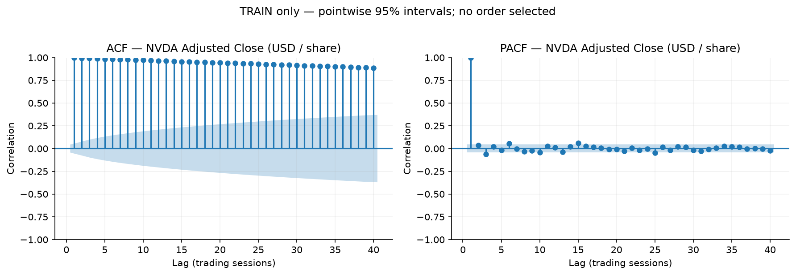

Figure A1 — Persistance des niveaux NVDA. Source : `outputs/figures/phase2/nvda_adj_close_acf_pacf_train.png`. Périmètre : TRAIN, 2018-01-02–2025-11-14. Unité : corrélation sans dimension ; retards en séances. La décroissance lente motive l’analyse de stationnarité, sans établir une structure autorégressive exploitable en niveau.

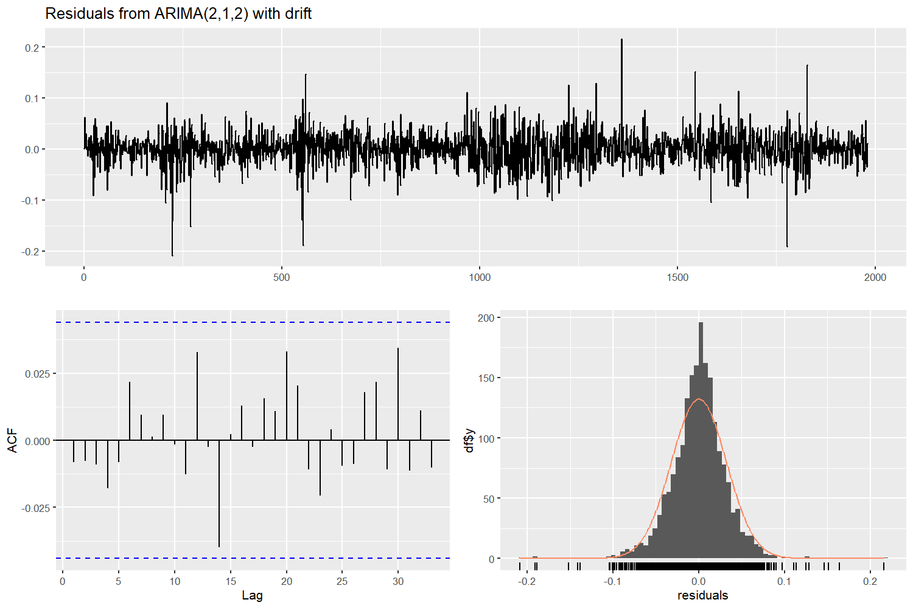

Figure A2 — Résidus du R ARIMA(2,1,2) avec drift. Source : `outputs/figures/phase3/nvda_arima_checkresiduals_r.png`. Périmètre : TRAIN, 2018-01-02–2025-11-14 ; résidus natifs du graphique R. Unité : log-prix pour les résidus, corrélation pour l’ACF, densité pour la distribution. La convention native inclut l’innovation initiale ; les tableaux formels la retirent, expliquant la petite différence de Ljung-Box. Une autocorrélation non détectée ne valide pas normalité et variance constante.

Tableaux détaillés associés : `outputs/tables/phase3_arima_residual_diagnostics_r.csv`, `outputs/tables/phase3_arima_residual_diagnostics_python.csv`, `outputs/tables/phase3_optimizer_sensitivity_python.csv`. Ils conservent les avertissements et conventions que les deux graphiques ne peuvent résumer.

<!-- pagebreak -->

## Annexe B Décomposition multivariée et variance résiduelle

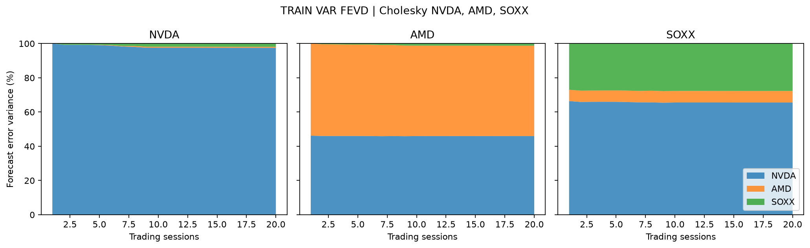

Figure B1 — Décomposition de variance d’erreur de rendement. Source : `outputs/figures/phase4/phase4_var_fevd.png`. Périmètre : VAR(9) TRAIN, horizons 1–20 séances. Unité : parts en %, somme 100 par réponse et horizon. Ordre NVDA, AMD, SOXX. La prépondérance de la première innovation reflète aussi l’identification récursive ; elle ne mesure pas une causalité structurelle.

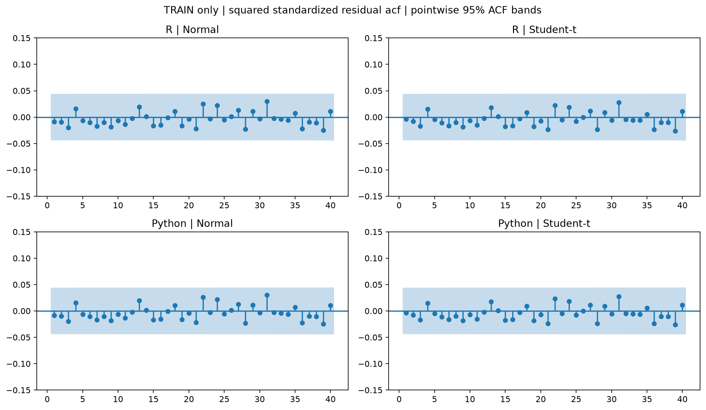

Figure B2 — Dépendance après filtrage GARCH. Source : `outputs/figures/phase5/phase5_squared_standardized_residual_acf.png`. Périmètre : 1979 innovations TRAIN, 2018-01-03–2025-11-14, R/Python et Normal/Student-t. Unité : corrélation sans dimension ; retards en séances, bandes ponctuelles à 95 %. L’absence de structure forte concorde avec les non-rejets aux lags testés et ne prouve pas iid.

Sources détaillées : `outputs/tables/phase4_var_fevd.csv`, `outputs/tables/phase5_garch_standardized_residual_diagnostics.csv`, `outputs/tables/phase5_tail_quantile_comparison.csv`. La table de quantiles explique le choix Normal dépendant de la règle, malgré les meilleurs critères Student-t.

<!-- pagebreak -->

## Annexe C Trajectoires finales et spécifications techniques

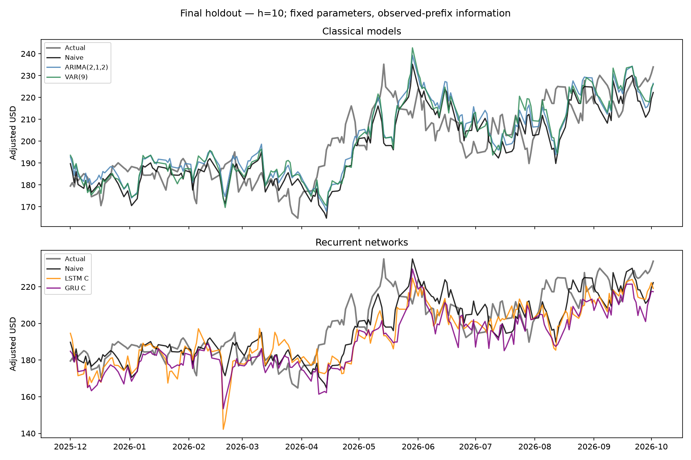

Figure C1 — Trajectoires alignées sur les dates cibles. Source : `outputs/figures/phase7/phase7_actual_vs_forecasts_h10.png`. Périmètre : TEST final, cibles 2025-12-01–2026-10-02, 211 origines par modèle. Unité : prix NVDA en USD ajustés. Les deux panneaux conservent Naive ; les trajectoires montrent les écarts neuronaux sans effacer les résultats défavorables. La proximité de courbes n’établit pas une égalité statistique.

Le fichier `outputs/tables/phase7_final_predictions.csv` contient les 2110 lignes officielles, soit cinq modèles × deux horizons × 211 origines. Son empreinte SHA-256 est `c49642b267f443b32649703341e3b83a045df75dc911e496e0d14d22b8ccee50`. Les métriques, DM et intervalles sont référencés plutôt que régénérés. Les événements d’accès, locks et comparaisons d’empreintes figurent dans `outputs/tables/phase7_runtime_audit.json` et les CSV de provenance Phase 7.

Les spécifications neuronales sont détaillées dans `docs/phase6_protocol.json` et `outputs/tables/phase6_configuration_scores.csv` ; les trois blocs temporels dans `outputs/tables/phase6_temporal_folds.csv` ; les scalers dans `outputs/tables/phase6_scaler_audit.csv`. Les poids locaux restent exclus de Git. TensorFlow 2.21.0 et Keras 3.15.1 ont été utilisés sur CPU ; le protocole demande des opérations déterministes et une seed 42, sans garantie interplateforme.

Versions classiques historiques : Python 3.12.3, statsmodels 0.15.0, pmdarima 2.1.1, arch 8.0.0 ; R 4.5.2, forecast 9.0.2, tseries 0.10.63, FinTS 0.4.9, vars 1.6.1, urca 1.3.4, rugarch 1.5.6. Les tables `phase*_runtime_versions*.csv` constituent la référence complète et distinguent les étapes.

<!-- pagebreak -->

## Annexe D Artefacts génératifs et reproduction

**Prompt et réponse intégrale.** Le prompt autonome est conservé dans `llm/prompts/phase8_official_llm_prompt.md` ; les faits et sources dans `llm/prompts/phase8_project_facts.md` et `llm/prompts/phase8_source_manifest.json`. La réponse intégrale A/B/C/D se trouve dans `llm/responses/phase8_official_llm_response.md`. Elle est conservée sans correction ni suppression, y compris son suffixe éditorial. Empreinte SHA-256 : `eecb0de3e0dd8e152e93db70ff71f9dad87024b7b2f3e1bee1ede05225f6f3b4`.

**Comparaison et audit.** `llm/human_analysis/phase8_human_vs_llm_comparison.md` contient la comparaison détaillée avec les baselines de développement assistées puis revues. `llm/human_analysis/phase8_hallucination_audit.csv` conserve les extraits, 35 supports, sources exactes et réserves. Le disclaimer académique est dans `llm/prompts/phase8_investment_disclaimer.md`. Ces artefacts doivent accompagner le dépôt remis : les chemins sont internes, pas des pages web publiques certifiées.

**Code Python et R.** La chaîne scientifique Python est constituée de `python/00_data_acquisition.py`, `python/01_data_preparation.py`, `python/01_data_eda.py`, `python/02_arima.py`, `python/02b_arima_validation.py`, `python/03_var_vecm.py`, `python/04_garch.py`, `python/05_lstm_gru.py` et `python/06_evaluation.py`. Les quatre vrais scripts R sont `r/02_arima.R`, `r/02b_arima_validation.R`, `r/03_var_vecm.R` et `r/04_garch.R`. `r/01_data_eda.R` reste un placeholder et n’est pas compté comme EDA R implémentée.

**Guides et packages.** `docs/team_setup_windows.md` décrit l’installation explicite Python/RStudio. `requirements.txt` et `requirements-dev.txt` listent les packages Python ; les packages R sont forecast, tseries, FinTS, vars, urca et rugarch. `docs/reproduction_guide.md` distingue FAST et FULL et précise la préparation d’un clone isolé. TensorFlow CPU doit être validé dans l’environnement de reproduction ; la documentation officielle précise la voie d’installation Windows [TensorFlow install](https://www.tensorflow.org/install/pip).

**Limite §8.3.** `notebooks/AI_Chip_Market_Intelligence.ipynb` est le notebook FAST exécuté. Un notebook FULL orchestré reste à implémenter et tester sur une machine vierge. Le runner Phase 7 refuse les prédictions préexistantes ; leur archivage ne doit concerner que la copie isolée. Les protocoles, l’historique et le gate de provenance doivent rester authentiques. Une divergence de snapshot ou de poids doit être rapportée, sans ajustement des locks ni réutilisation de l’ancien audit comme preuve d’un nouveau run. La réponse LLM officielle est un document à préserver, sans promettre sa régénération identique.

**Périmètre documentaire.** Le PDF intégral du cahier des charges n’est pas disponible pour l’audit. Cette limite réduit la certification documentaire des clauses ; elle ne constitue pas un livrable scientifique obligatoire manquant. Les exigences transmises, dont la pagination et §8.3, restent explicitement prises en compte.
